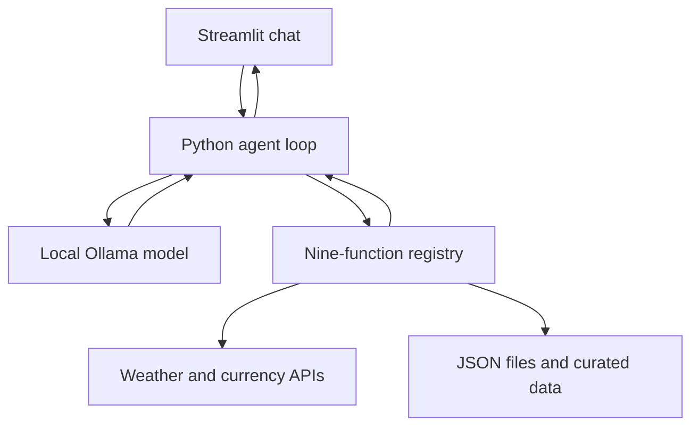

# Travel Studio — Travel Planning Assistant

A local Ollama agent with a Streamlit chat interface, **exactly nine tools**, a visible execution trace, and persistent JSON itineraries. No cloud LLMs, bookings, payments or emails.

## Assumptions and scope

- Python 3.11 or 3.12 recommended; Windows PowerShell instructions below.
- Default model: **qwen2.5:3b**, a compact 3-billion-parameter model with tool support. It reduces laptop memory requirements compared with larger models. Tool selection is probabilistic: small models can miss instructions and need follow-up prompts. No guarantee of perfect autonomous planning.
- Supported curated destinations: Colombo, Kandy, Paris and London. Weather can geocode other cities, but the attraction, travel and tips catalog cannot.
- Prices are illustrative USD estimates, not live admissions. Travel times use approximate coordinates, assumed speed and a distance multiplier; no road routing or traffic API.
- Weather and exchange rates require internet. The LLM remains local. API requests send city/coordinates or currency codes, not the conversation.
- Budget includes meals, admissions, local transport and contingency, excluding flights/accommodation. All inputs must use one currency.
- This is an assignment-quality local application, not a public multi-user service. Saved files are shared by sessions on the same machine; no authentication is provided.

## 1. Install Ollama and the model

Install Ollama from https://ollama.com/download and start the Ollama application.

```powershell
ollama pull qwen2.5:3b
ollama run qwen2.5:3b "Say hello in one sentence"
```

If Ollama is not running, launch its desktop app or run `ollama serve` in a separate terminal. Do not start another server if one is already listening on port 11434.

## 2. Install this project

Extract the ZIP, open a terminal inside `travel_agent`, then run:

```powershell
python -m venv .venv
.\.venv\Scripts\python.exe -m pip install -r requirements.txt
Copy-Item .env.example .env
```

No API keys are needed. `.env` is optional because defaults are supplied. To use the alternative supported model, pull `llama3.2:3b` and set `OLLAMA_MODEL=llama3.2:3b`. Ollama host configuration is restricted to loopback addresses to keep inference local.

## 3. Start the Streamlit app

With the environment activated:

```powershell
.\.venv\Scripts\Activate.ps1
python main.py
```

Or:

```powershell
streamlit run main.py
```

**Both commands start Streamlit and show the local URL, normally http://localhost:8501.** `python main.py` launches Streamlit through the same Python interpreter and binds it to localhost. It does not start a terminal chatbot. Streamlit normally opens a browser; if it does not, open the printed URL manually.

If PowerShell blocks activation, no policy changes are needed:

```powershell
.\.venv\Scripts\python.exe main.py
# Alternative:
.\.venv\Scripts\python.exe -m streamlit run main.py
```

Press Ctrl+C in the terminal to stop. If port 8501 is occupied, stop the earlier instance or use `python main.py --server.port=8502` and follow Streamlit's actual printed URL. On macOS/Linux use `python3 -m venv .venv`, `source .venv/bin/activate`, then the same pip/run commands.

## Tool selector beside the message box

Choose **All tools · full trip planning** to let the agent use whichever of the nine tools your request needs. It does not automatically execute all nine or save files unless requested.

Choose Weather, Attractions, Travel time, Budget, Save itinerary, Load itinerary, Currency conversion, Packing list or Local tips to limit this request to that tool. Enter the required details in the adjacent message box and send. The placeholder changes to an example for your selection. Selection alone does not run a tool. Missing information may cause the agent to ask a question.

The backend filters the schemas sent to Ollama and rejects calls to unselected tools. Switching selection preserves chat history. For combined tasks, choose All tools. Saving alone requires an existing complete plan in the conversation.

### Updating an existing installation

Stop the app with Ctrl+C. From the updated ZIP, copy `main.py` and `agent.py` into your existing project folder, replacing those two files. On the example Windows installation this is `C:\Users\kasun\Downloads\travel_agent\travel_agent\`. Keep your existing `.venv`, `.env` and `data` folder. No new dependencies are required. Optionally replace `tests/test_project.py`, README.md and VALIDATION.md for updated tests/documentation. Restart with `python main.py`.

## 4. Example prompts

Replace dates as needed. Forecasts are only available from today through the next 15 days; a farther-future trip is provisional, not a forecast.

1. **Full multi-step plan:** “Plan 2 days in Colombo starting tomorrow for one traveler with USD 70. I like museums and parks. Call get_weather, search_attractions and get_travel_time for the planned legs. Use calculate_budget including meals, admissions, local transport and 10% contingency, excluding flights and accommodation. Add get_local_tips and a get_packing_list based on available weather. Save the complete daily plan and budget as colombo_trip.json using save_itinerary. If weather is unavailable, say so.”
2. **Currency and follow-up:** “Plan 3 days in Paris starting tomorrow for two travelers with a total EUR 400 budget. Use get_currency_conversion to convert my budget to USD before comparing it with catalog USD prices. Find museums and parks, check weather, estimate travel times, calculate the full group cost, add tips and packing, and save paris_trip.json.” Then: “Make day 2 cheaper, keep the same dates and travelers, recalculate the budget and overwrite paris_trip.json with the complete revised itinerary.”
3. **Reload and revise:** “Load colombo_trip.json using load_itinerary. Replace one paid activity with a free park from search_attractions. Recheck travel times, recalculate the whole budget, refresh weather if dates are within the forecast window, update packing and save the complete revised plan as colombo_revised.json.”

The prompts request tool use; the model still chooses calls. Check the trace to verify what actually ran. Prompt 3 requires completing prompt 1 first. For repeat demos choose new filenames or explicitly ask to overwrite.

## Nine tools

| Tool | Inputs | Behavior |
|---|---|---|
| get_weather | city, start_date, days | Open-Meteo geocoding and live daily forecast; date/units/source included |
| search_attractions | city, interests | Curated names, coordinates and illustrative per-person USD prices |
| get_travel_time | city, origin, destination, mode | Approximate distance/minutes for exact catalog names |
| calculate_budget | days, travelers, daily_meals, daily_transport, total_admissions, budget, currency, contingency_percent | Decimal-based whole-group arithmetic and budget check |
| save_itinerary | filename, itinerary_json, overwrite | Validate and persist complete JSON to data/ |
| load_itinerary | filename | Read and validate saved JSON |
| get_currency_conversion | amount, from_currency, to_currency | Frankfurter reference rate, conversion and rate date |
| get_packing_list | min_temperature_c, max_temperature_c, rain_probability, activities | Deterministic packing rules |
| get_local_tips | city | Curated food suggestions, etiquette and general precautions |

Every registered function has typed parameters, a detailed docstring and a `safe_tool` wrapper. Success is `{"ok": true, "data": ...}`; invalid input/API/file errors return `{"ok": false, "error": ...}`. Helpers starting with `_` are not tools. As with any application, process termination, hardware failure and out-of-memory conditions cannot be guaranteed recoverable.

Frankfurter v1 supplies reference rates, not transaction quotes. Unsupported currencies such as LKR return an error; no exchange rate is invented. The API's v1 remains supported but is deprecated in favor of v2; future migration is documented as maintenance work.

## Architecture and agent loop



`run_agent` is deliberately a plain loop, not a framework:

1. Append the user's message to the history.
2. Send history and the nine function schemas to local Ollama.
3. Append the assistant message including its tool requests.
4. If there are no calls, display the final response and stop.
5. Otherwise execute every requested call through the whitelist, emit live trace events, and append each JSON result as a `tool` message with `tool_name`.
6. Repeat until the model answers or **10 model requests** have been made. After the tenth request, requested tools are still answered, then the application emits a limit notice. It never makes an eleventh model request automatically.

Ollama's SDK derives tool schemas from function signatures/docstrings. The decorator preserves them using `functools.wraps`. Unknown tools and malformed arguments become results the model can correct. The application does not execute arbitrary model-generated code.

## Conversation memory and saved plans

`st.session_state.messages` holds system, user, assistant and tool messages across Streamlit reruns. `turns` holds visible answers/traces. Follow-ups reuse all recorded messages. New conversation clears chat memory but not files. Browser/session loss can discard chat history; JSON plans persist on disk. Full history is passed to Ollama, but the finite 16,384-token model context cannot guarantee recall in arbitrarily long chats. Start a new chat and load a saved plan when needed.

Files are written under `travel_agent/data/`, independent of the shell's working directory. A valid example structure is:

```json
{"destination":"Colombo","days":[{"date":"2027-01-10","activities":["Visit National Museum","Walk in Viharamahadevi Park"]}],"budget":{"currency":"USD","total":35,"scope":"Example only"}}
```

The model should save the full actual plan, not this example. Files must have a simple `.json` name. Traversal and symlinks are rejected. Existing files require explicit overwrite intent; the tool's boolean is checked but user intent enforcement is prompt-based. Keep this application local to a trusted user. The sidebar downloads validated saved plans. JSON content is schema-checked but not a formal proof that every narrative claim matches a tool result.

## Tests and honest validation

```powershell
.\.venv\Scripts\python.exe -m unittest discover -s tests -v
```

Tests cover nine-tool registration, invalid inputs, group budget math, file round-trip/overwrite/path protection, malformed files, API failures, currency fixtures, multiple calls, follow-up history, unknown tools, malformed JSON arguments, the 10-step limit, model errors and Streamlit chat rendering. Fake clients and HTTP fixtures make these tests run without Ollama or internet. They do **not** prove live model quality or API availability. See VALIDATION.md for results from the build environment and a real-machine acceptance checklist.

## Troubleshooting

- Connection error: start Ollama; verify `ollama list` includes the configured exact model.
- Slow response: the first model load takes time. Close memory-heavy apps; wait for the step indicator. Model timeout is 180 seconds per request.
- No saved file: inspect `save_itinerary` in the trace. A model statement alone is not proof. Fix validation errors or explicitly ask it to call the tool.
- API unavailable: check internet and retry. Tools use connection/read timeouts; no fabricated fallback live data.
- Wrong city: inspect the resolved city/country in the forecast result. Geocoding takes the first match, so use a more specific place name.
- Multi-step task reaches limit: inspect completed actions; continue with a narrower request, or load the saved plan in a new conversation.

## Assignment submission and attribution

The guide requires a **group of 2 or 3**, a shared Git repository showing each member's contributions, a **1,500–2,500-word PDF report**, a **3–5-minute demo video** with two tasks and traces, and a **10-minute viva**. Code alone is not the complete university submission. See VIVA_AND_SUBMISSION.md. Do not invent contributions or claim unperformed tests.

Original implementation prepared with AI assistance. Disclose that assistance in your report appendix and explain every submitted line. Libraries: official Ollama Python SDK, Streamlit, Requests, python-dotenv, and tzdata. API data attribution: Open-Meteo and Frankfurter. Curated catalog values are illustrative and not sourced live.

References:
- https://github.com/ollama/ollama-python
- https://ollama.com/library/qwen2.5:3b
- https://ollama.com/blog/functions-as-tools
- https://docs.streamlit.io/
- https://open-meteo.com/en/docs
- https://open-meteo.com/en/docs/geocoding-api
- https://frankfurter.dev/v1/
