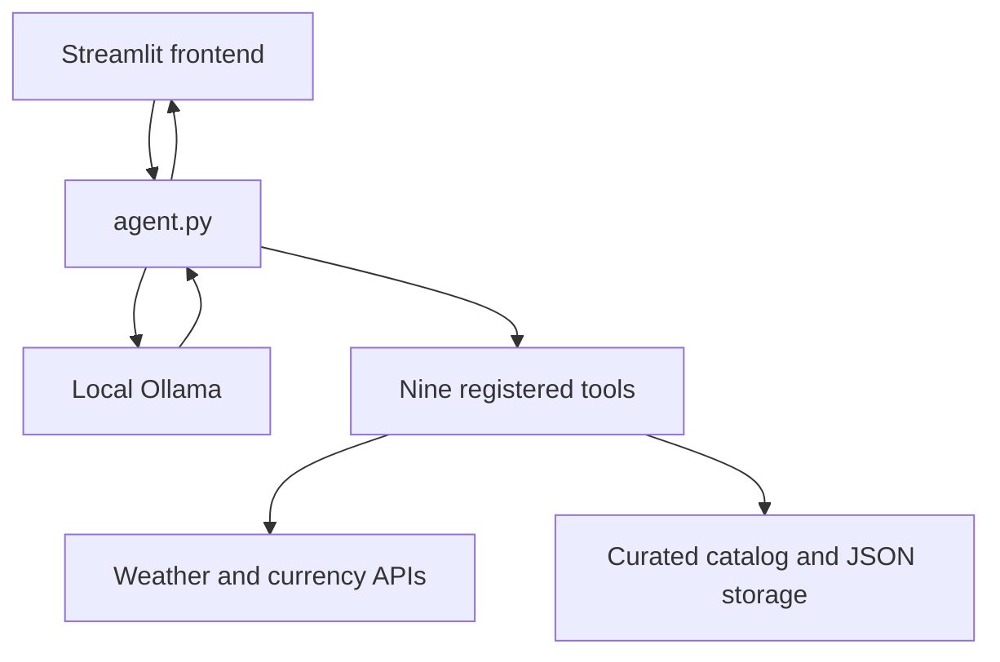

# Architecture and stable interface — Member B

One local tool-using agent; no multi-agent framework or web API server is required.

## Stable contract

`run_agent(messages, user_text, client=None, selected_tool=None)` is a generator. It appends full conversation messages to the supplied list. `None` enables all nine tools; a named selection enables only that function. An invalid selection returns a final explanation without executing anything.

| Event | Required fields | UI behavior |
| step | type, step | Show progress |
| tool_start | type, step, name, arguments | Display request before execution |
| tool_result | type, step, name, arguments, result | Show JSON result |
| final | type, content | Render final response |

Tools return either `{ "ok": true, "data": ... }` or `{ "ok": false, "error": "..." }`. The public registry remains exactly nine functions. Shared helpers are not exposed as tools.

No member changes these names without agreement in a GitHub issue. Frontend owns session_state and presentation; agent owns model orchestration; tools own calculations/data. Frontend may call load_itinerary to validate a download; that sidebar action is separate from the agent's trace.

## Boundaries and limitations

- Ollama host is limited to localhost/loopback; model must be qwen2.5:3b or llama3.2:3b.
- Weather and exchange rates need internet; local inference does not mean all tools are offline.
- Full history is retained in session_state and passed on each call; finite model context can limit long-chat recall.
- File storage is shared by sessions on the same local machine. This is not an authenticated public service.
- Model outputs remain probabilistic. Tool validation does not prove that the narrative exactly matches the complete tool trace.
